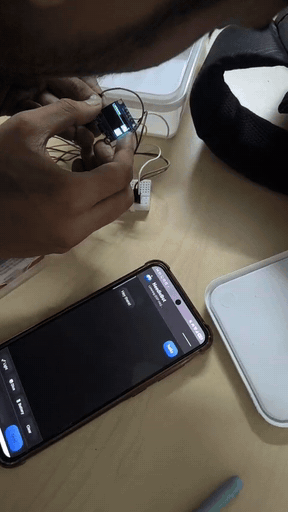

# NeedleBot

An offline-first voice assistant that spans three layers — a custom **ESP32‑S3** device, a **host** (laptop or phone), and a small **local LLM** used purely as an intent router. "Needle" takes a spoken or typed command, classifies it locally, runs a **whitelisted** action (open an app, do math, tell the time, answer a fact, toggle the flashlight, search the web…), and sends the reply back to the device's OLED.

No cloud required: speech, classification, and actions all run on-device.

## Demo



*The ESP32-S3 (with OLED) and the NeedleBot phone app exchanging commands over BLE.*

## Architecture

```
ESP32-S3  --BLE-->  Host  -->  Needle 3 (local LLM, used only to classify intent)
 mic + OLED        host app        |
                                   v
                         whitelisted action -> template reply -> BLE -> OLED
```

There are two implementations of the host:

- **Phase 1 (working):** `needle_host.py` — Python, uses `bleak` for BLE. Runs on a laptop or in Termux on the phone.
- **Phase 2 (in progress):** a native **Android** app in `android/` (Kotlin) with **Vosk** offline speech-to-text — built because `bleak` has no Android backend. See `PHASE2_PLAN.md` and `android/README.md`.

## How it works

1. The ESP32‑S3 captures a command and sends the text over BLE (notify characteristic).
2. The host classifies the text with Needle 3 **as an intent classifier only** — not for free-form generation.
3. The matching handler runs a whitelisted action and builds a template reply.
4. The reply is written back over BLE and shown on the OLED.

## Capabilities

Intents are defined in `tools.json`: greeting, status, joke, arithmetic, time, date, robot info, general-knowledge facts, open app, device actions, and web search. Data and whitelists live in JSON so behaviour can be edited without touching code:

- **App launching** — `apps.json`: spoken name → fixed `argv` command (camera, browser, settings, clock, maps).
- **Device actions** — `devices.json`: phrase → fixed command via Termux:API (flashlight/torch, volume, battery, vibrate).
- **Facts** — `facts.json`: curated question → answer.

> **Safety by design:** app launches and device actions are **argv-only whitelists**. Free user text is never passed to a shell.

## Repository layout

```
needle_host.py                 Phase 1 BLE <-> intent bridge (Python)
tools.json                     Intent definitions for the classifier
apps.json / devices.json       Whitelisted app launches & device actions
facts.json                     Curated general-knowledge answers
esp32_firmware/src/main.cpp    ESP32-S3 firmware (OLED, notification mirror, voice)
android/                       Phase 2 native host (Kotlin, Vosk STT, BLE central)
test_host.py                   Host tests
.github/workflows/android.yml  CI: builds the Android debug APK
PHASE2_PLAN.md / PHASE3_PLAN.md Roadmap
```

## Status

- **Phase 1** (Python host + ESP32 firmware): working.
- **Phase 2** (Android host): scaffolded and building via CI; not yet device-tested (see `android/README.md`).
- **Phase 3** (planned): alarms, timers, calendar, notes, SMS, media, volume, weather.

## Running (Phase 1)

Requirements: Python 3, `bleak`, an ESP32‑S3 flashed with `esp32_firmware/`, and a local Needle 3 model with `tools.json`.

```bash
pip install -r requirements.txt
python needle_host.py
```

Adjust the model and tool paths at the top of `needle_host.py` to match your setup. To run the host on the phone instead, follow `android/README.md`.

## Tech stack

Python · Kotlin (Android) · C++ (ESP32‑S3) · BLE · Vosk (offline STT) · Termux:API · local LLM (Needle 3)

---

*Personal project by Mirza Fasahatulla Baig — ECE student, robotics & embedded systems.*
